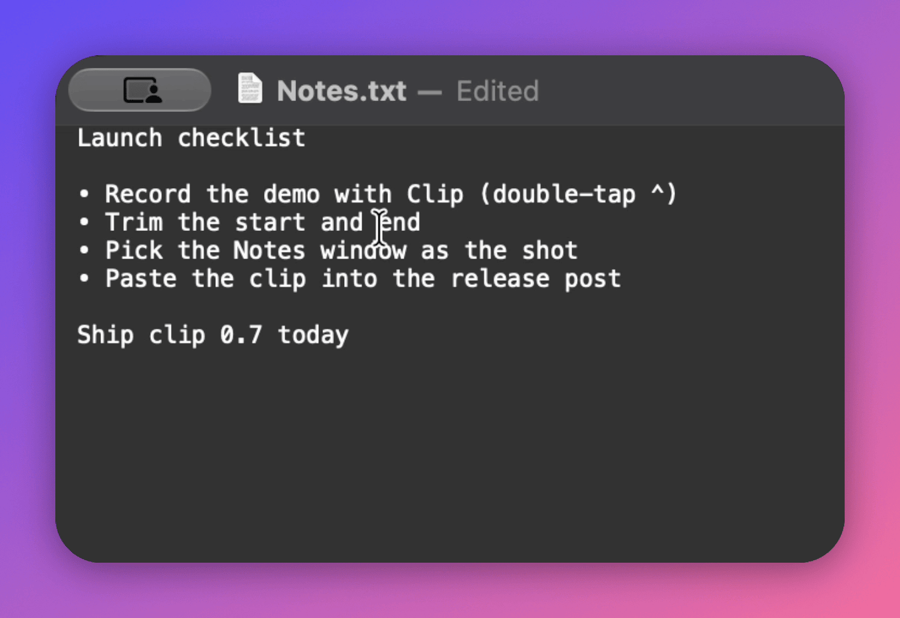
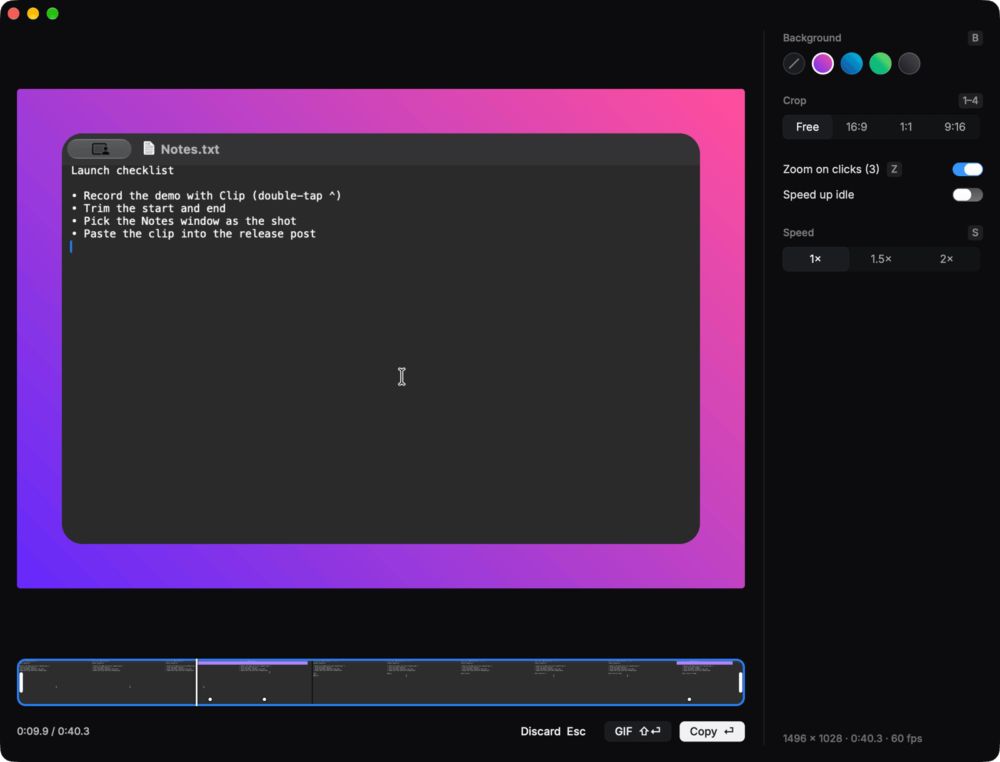
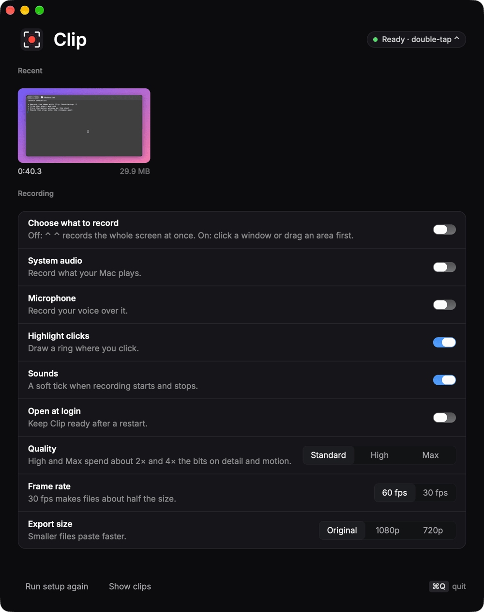

# Clip

<a href="https://opencode.ai"><picture><source media="(prefers-color-scheme: dark)" srcset="https://opencode.ai/brand/badges/opencode-built-with-g-dark-20.svg"></picture></a>

Double-tap ⌃ Control to record your screen. Tap it again to stop, then trim,
crop, pick a window to follow and paste the clip anywhere. A Rune app for macOS.



Every recording opens in a review: trim it, crop it to 16:9, 1:1 or 9:16, zoom
in where you clicked, speed it up, add a background, and press ⏎ to copy it as a
video (or ⇧⏎ for a GIF), ready to paste.





## Install

1. Download **[Clip.dmg](https://github.com/anomalyco/clip/releases/latest/download/Clip.dmg)**
   (macOS 15 or later, Apple silicon).
2. Open it and drag **Clip** into **Applications**.
3. Open Clip from Applications and follow its setup: it asks for Screen
   Recording, then lives in the menu bar.

Clip updates itself: when a new version is ready, choose **Restart to Update**
in its menu bar menu, or just quit. Install it in Applications (not run from
Downloads or the disk image) so it can replace itself.

Dev builds, which update to every new dev build, are the
[prereleases](https://github.com/anomalyco/clip/releases).

## Build

```sh
cargo run                  # a debug build
scripts/bundle.sh          # target/Clip.app
```

Releasing: [docs/releasing.md](docs/releasing.md).
